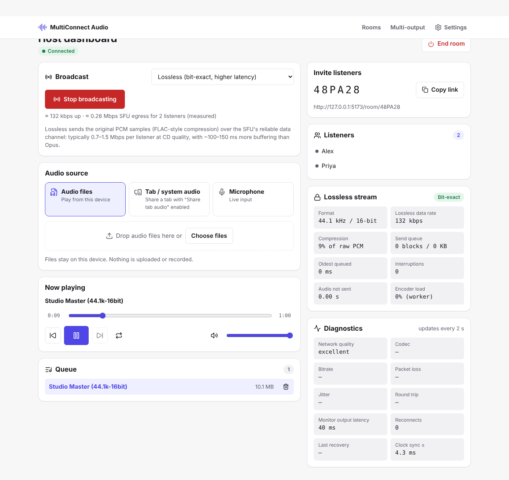
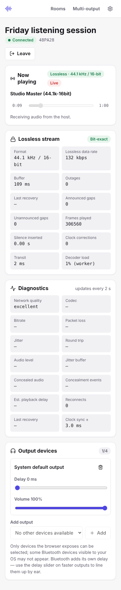

# MultiConnect Audio

Real-time audio sharing in the browser. One host streams music, a browser tab
or a microphone to many listeners through a WebRTC SFU, and any device can
play one source on several output devices at once.

- **Frontend**: React 19 + TypeScript (strict) + Vite, plain CSS, Lucide icons.
- **Media transport**: [LiveKit](https://livekit.io) SFU (open source; native
  binary or LiveKit Cloud) with the `livekit-client` SDK.
- **Control plane**: FastAPI. It handles rooms, host authorization and
  short-lived media tokens. Audio never passes through it and is never stored.

No containers are needed: every piece runs as a native process.

---

## Quick start (local)

Requirements: Node 22+, Python 3.11+, and the
[LiveKit server binary](https://github.com/livekit/livekit/releases) (v1.12.0
tested) on your `PATH`.

```bash
# 1. dependencies
cd backend && python3 -m venv .venv && . .venv/bin/activate && pip install -r requirements-dev.txt && cd ..
cd frontend && npm ci && cd ..

# 2. run everything (LiveKit :7880, API :8000, web :5173)
PYTHON=backend/.venv/bin/python ./scripts/dev.sh

# Phones/laptops on the same Wi-Fi can join at http://<this-machine's-IP>:5173
# (the SFU advertises your network IP; override with NODE_IP=… if needed)
```

Open http://localhost:5173, click **Create room**, add an audio file, and click
**Go live**. Open the invite link in another browser or device to listen.

> Browsers only allow microphone or tab capture and output-device selection on
> `https://` pages or `localhost`. Other devices on your LAN therefore need
> HTTPS. Put a reverse proxy with a certificate in front of the app, as in
> `deploy/nginx.conf`, or use a tunnelling tool.

---

## Screenshots

| Host dashboard (lossless, 2 listeners)                   | Listener (phone width)                                        |
| -------------------------------------------------------- | ------------------------------------------------------------- |
|  |  |

More in [`docs/screenshots/`](docs/screenshots/).

---

## Broadcast modes

| Mode                   | What listeners get                                                                             | Latency (measured, localhost) | Bandwidth per listener                                   |
| ---------------------- | ---------------------------------------------------------------------------------------------- | ----------------------------- | -------------------------------------------------------- |
| **Lossless** (default) | The source's exact integer samples, up to **24-bit / 192 kHz**. Verified bit-exact end to end. | ~55–65 ms median (adaptive)   | ~1.0 Mbps (CD) to ~7.4 Mbps (192/24); depends on content |
| **Studio** (Opus)      | Opus at its 510 kbps maximum, 48 kHz stereo. Perceptually transparent but lossy.               | ~45 ms median                 | ~510 kbps                                                |
| High / Standard (Opus) | 128 / 64 kbps Opus, with optional loss protection (RED)                                        | ~45–60 ms                     | ~260 / 130 kbps with RED                                 |

**Lossless** sends PCM blocks over LiveKit's reliable, ordered data channel.
They are compressed with a FLAC-style codec: fixed linear prediction, mid/side
stereo and Rice coding. It is **not** the FLAC file format. WAV and FLAC
sources keep their native sample rate and bit depth, so nothing is resampled.
Lossy sources (MP3, AAC) are carried as the browser decodes them, at 24-bit.

What "lossless" guarantees, and what it doesn't:

- Every frame that is delivered is bit-exact. When continuity can't be kept
  (overload, network stall, restart), the stream reports an **explicit
  interruption** and playback restarts cleanly. Audio is never silently
  dropped, and playback never splices across a gap.
- The playback buffer adapts to the connection (auto mode) using a hybrid of
  three models: a short-term one (the spread of block arrival times over the
  last ~10 s, measured on the audio thread), a long-term one (a decaying
  memory of recent stalls, 30 s half-life) and a reactive one (a step up after
  any underrun). It starts at 40 ms (floor 20 ms), rises at once when jitter
  grows and falls only after calm, so it sits at the lowest buffer the
  connection sustains. Stable mode uses a fixed 300 ms buffer.
- The listener's playback buffer runs on the listener's audio clock. The
  worklet judges drift on a ~2 s smoothed buffer level and, when it leaves
  the target by more than a window (a quarter of the target, 5–40 ms), skips
  or repeats single frames until it is back within half the window. The
  adaptive buffer also uses this to follow its own target changes, so
  corrections are not rare: in the 120 s latency-profile runs the listener
  made 196–2,720 single-frame corrections per run (median ~1,700, about
  14 per second). With the old fixed 120 ms buffer the 10-minute soak showed
  none for 8.5 of its 10 minutes. Every skipped or repeated frame is counted
  (decoded = played + skipped + buffered), and the decoded audio stays
  bit-exact; playback skips or repeats single frames.
- Output devices, the OS mixer and **Bluetooth** (which re-encodes with
  SBC/AAC/LDAC) sit outside the browser, so lossless can't extend through
  them.

---

## Architecture

```
Host browser                                  LiveKit SFU                 Listener browser
────────────                                  ───────────                 ────────────────
file ─► <audio> ─► Web Audio tap ──┬─ Opus track ──────────► forwards ───► <audio> per output
mic / tab capture ─────────────────┤                                       (setSinkId, delay)
                                   └─ capture worklet ─► codec worker ─►
                                      (int PCM blocks)   (encode)   data channel ─► codec worker ─► playback worklet
                                                                    (reliable)       (decode)       (jitter buffer)
FastAPI: create room · host key · short-lived role-scoped tokens   (no media)
```

Key frontend modules (`frontend/src`):

| Area                    | Files                                                                                                                                                                                                             |
| ----------------------- | ----------------------------------------------------------------------------------------------------------------------------------------------------------------------------------------------------------------- |
| Audio engine (no React) | `audio/LocalFilePlayer.ts`, `audio/MultiOutputPlayer.ts`, `audio/driftCorrector.ts`, `audio/capabilities.ts`, `audio/outputDevices.ts`, `audio/sourcePolicy.ts`                                                   |
| Lossless transport      | `audio/lossless/codec.ts`, `captureAssembler.ts`, `captureLifecycle.ts`, `captureWorklet.ts`, `playbackWorklet.ts`, `codecWorker.ts`, `pipeline.ts`, `flowControl.ts`, `LosslessSender.ts`, `LosslessReceiver.ts` |
| Room / WebRTC           | `services/roomConnection.ts` (idempotent connect, in-place track replacement), `services/hostSession.ts`, `services/listenerSession.ts`                                                                           |
| Sync                    | `services/syncService.ts`, `services/syncProtocol.ts`, `utils/clock.ts` (NTP-style server-clock offset)                                                                                                           |
| UI                      | `pages/*`, `components/*`. Playback time and meters are written straight to the DOM through refs, so playing audio doesn't re-render React.                                                                       |

### Lossless pipeline guarantees

- **Bounded queues** (`flowControl.ts`). Encode, send and decode queues are
  each limited by block count, bytes and age of the oldest block (50 blocks,
  2 MB and 750 ms by default). Going over a limit starts an explicit
  interruption, which ends once the queue drains to 25% of its limit. These
  capacities haven't been tuned yet; see _Future work_.
- **Continuity metadata** (block header v2): `seq`, a `firstFrame` position on
  the AudioContext timeline, `captureMs` on the shared server clock (ms, mod
  2³²; error is bounded by the clock-sync uncertainty shown in diagnostics),
  and a `discontinuity` flag. Receivers reject duplicate, stale and reordered
  blocks, and treat any unannounced gap as a break in continuity.
- **Generation safety** (`captureLifecycle.ts`). There is one long-lived
  capture worklet per AudioContext, and start/stop run as generations on it.
  Async starts that were superseded never attach. Blocks from a stale
  generation are refused and recorded, and late worker replies are ignored.
- **Frame accounting**, reconciled exactly in the integration tests:
  - Sender: captured + capture-gap = sent + interrupted.
  - Network: sent = received + receiver-interrupted.
  - Receiver: received = decoded.
  - Playback: decoded = played + skipped + buffered.

---

## Environment variables

Backend (`backend/.env`; see `backend/.env.example`):

| Variable                                                                               | Default               | Meaning                                                                                     |
| -------------------------------------------------------------------------------------- | --------------------- | ------------------------------------------------------------------------------------------- |
| `APP_ENV`                                                                              | `development`         | `production` requires `wss://`, `https` CORS origins and a non-dev secret of 32+ characters |
| `LIVEKIT_URL`                                                                          | `ws://localhost:7880` | Public SFU URL given to browsers                                                            |
| `LIVEKIT_API_URL`                                                                      | = `LIVEKIT_URL`       | Server-to-server URL for RoomService                                                        |
| `LIVEKIT_API_KEY` / `LIVEKIT_API_SECRET`                                               | dev values            | Kept on the backend only                                                                    |
| `LIVEKIT_ROOM_ADMIN`                                                                   | `true`                | Pre-create rooms (participant limit, idle timeout) and close them via RoomService           |
| `CORS_ORIGINS`                                                                         | localhost:5173        | JSON list                                                                                   |
| `HOST_TOKEN_TTL_SECONDS` / `LISTENER_TOKEN_TTL_SECONDS`                                | 600 / 300             | Token lifetime; LiveKit refreshes tokens on live connections                                |
| `ROOM_TTL_SECONDS`, `ROOM_IDLE_TIMEOUT_SECONDS`, `MAX_ROOMS`, `MAX_LISTENERS_PER_ROOM` | 21600, 300, 1000, 100 | Limits                                                                                      |
| `RATE_LIMIT_CREATE_PER_MINUTE`, `RATE_LIMIT_TOKEN_PER_MINUTE`                          | 10, 60                | Per-IP limits (in-process)                                                                  |
| `TRUST_PROXY_HEADERS`                                                                  | `false`               | Use `X-Forwarded-For`; enable only behind a trusted proxy                                   |

Frontend (`frontend/.env`): `VITE_API_BASE_URL`. Leave it empty to use the
same origin; the Vite dev server proxies `/api`.

---

## Testing

```bash
cd backend && pytest -q && ruff check . && ruff format --check .
cd frontend && npm run lint && npm run typecheck && npm test   # 126 unit tests
cd frontend && npm run bench:codec                                # codec benchmark → bench/results/*.json

# Browser tests need a LiveKit server (dev keys):
livekit-server --config deploy/livekit.dev.yaml &
cd frontend && npx playwright test e2e/streaming.spec.ts e2e/lossless.spec.ts e2e/harness.spec.ts
```

Main suites:

| Suite                                                               | What it proves                                                                                                                      |
| ------------------------------------------------------------------- | ----------------------------------------------------------------------------------------------------------------------------------- |
| `tests/unit/losslessCodec`, `bitio`                                 | Bit-exact round trips (silence, impulses, extremes, noise, 1–8 channels, 16/24-bit), protocol validation, a 2,000-case garbage fuzz |
| `tests/unit/captureAssembler`                                       | Channel-layout changes and timeline gaps at every offset within a block; no lost or mixed frames                                    |
| `tests/unit/captureLifecycle`                                       | Start/stop races driven by deferred promises: no stale attach, at most one producer                                                 |
| `tests/unit/losslessPipeline`                                       | Deterministic overload simulations: slow encoder, slow or stalled network, slow decoder, restarts; checks exact accounting          |
| `e2e/streaming`                                                     | Real LiveKit: audible Opus delivery, join/leave leaks, duplicate-host takeover, Studio reaches 510 kbps                             |
| `e2e/lossless`                                                      | Real LiveKit: bit-exact delivery at 44.1/16, 96/24 and 192/24                                                                       |
| `e2e/harness`                                                       | Real worker and worklets with a controllable link: stall, slow link, restarts, reordering, lifecycle soak                           |
| `e2e/latency`, `latency-profile`, `perf`, `cpu`, `hires-throughput` | Benchmarks, run manually (not in CI); `scripts/latency-trials.sh` interleaves latency-profile trials                                |

---

## Performance measurements

All numbers were measured in a cloud Linux container with headless Chromium
(Playwright) and LiveKit 1.12.0 on localhost. Real networks, phones and
Bluetooth will differ. Re-run the specs to measure your own setup.

| Metric                     | Result                                                                                                                                                                                                                            | How                                                                                               |
| -------------------------- | --------------------------------------------------------------------------------------------------------------------------------------------------------------------------------------------------------------------------------- | ------------------------------------------------------------------------------------------------- |
| Initial JS (gzip)          | ~101 KB of 250 KB budget; LiveKit SDK (~141 KB) loads lazily                                                                                                                                                                      | `npm run build && npm run size`                                                                   |
| Opus pipeline latency      | median ~45 ms (Studio, 'interactive' tap) vs ~68 ms with 'playback' (3 runs each)                                                                                                                                                 | `e2e/latency.spec.ts`: onset detection on a click track, host pre-encode to listener post-decode  |
| Lossless latency           | adaptive buffer, 4 interleaved 120 s trials: median 62 ms (trials 57–77), p99 81 ms, 0 outages; with 2 busy loops 80 / 112 ms. Earlier untraced runs: 53 / 73 ms clean, 62 / 83 ms at 3% loss (fixed 120 ms buffer: 116 / 127 ms) | `e2e/latency-profile.spec.ts` (per-stage, see Lossless latency profile) and `e2e/latency.spec.ts` |
| Loss protection            | at 3% packet loss, concealment events 46 → 0 with RED (128 kbps)                                                                                                                                                                  | same, CDP packet-loss emulation                                                                   |
| Host uplink vs listeners   | flat for 1, 2, 4 and 8 listeners: Opus Studio 510 kbps every time; lossless 139–173 kbps (test tone)                                                                                                                              | `e2e/perf.spec.ts -g fan-out` with `PERF_TRANSPORT=opus` or `lossless`                            |
| Lossless 192/24 throughput | ~7.4 Mbps sustained for 30 s, steady ~125 ms buffer, 0 underruns                                                                                                                                                                  | `e2e/hires-throughput.spec.ts`                                                                    |
| Codec (192/24 music)       | encode ~11 ms / decode ~12 ms per second of audio (was 116 / 72); identical compression                                                                                                                                           | `npm run bench:codec`, baseline in `bench/results/baseline.json`                                  |
| Codec allocations          | 1 typed array per block (the output)                                                                                                                                                                                              | same                                                                                              |

**CPU** (percent of one core, 15 s window; host and listener each in their own
browser instance, so all their processes are counted; `e2e/cpu.spec.ts`):

| Scenario                          | Host total | Host main thread | Listener total | Listener main thread |
| --------------------------------- | ---------- | ---------------- | -------------- | -------------------- |
| Opus Studio                       | 22%        | 2.6%             | 17%            | 1.9%                 |
| Lossless 44.1/16                  | 28%        | 4.7%             | 30%            | 4.7%                 |
| Lossless 192/24 (codec in worker) | 48%        | 7.2%             | 42%            | 6.6%                 |
| Lossless 192/24 (codec inline)    | 47%        | 8.8%             | 41%            | 8.8%                 |

The codec worker moves ~2 points off the main (UI) thread, but total CPU stays
the same. Most lossless cost is the browser's data-channel and Web Audio work,
not the codec.

**Long-running sessions** (`e2e/perf.spec.ts -g soak`, lossless, 3-track
queue on repeat, host + 1 listener):

| Run                         | Heap growth (host / listener) | DOM nodes / event listeners | Underruns / resyncs / reconnects | Clock corrections                                              |
| --------------------------- | ----------------------------- | --------------------------- | -------------------------------- | -------------------------------------------------------------- |
| 60 min (before smoothing)   | +0.39 MB / +0.63 MB           | unchanged                   | 0 / 0 / 0                        | 27,384 (~0.57 s of single-frame skips/repeats)                 |
| 10 min (smoothed corrector) | +0.08 MB / +0.21 MB           | unchanged                   | 0 / 0 / 0                        | 2,372, all in one ~1.5 min recovery after a burst; 0 otherwise |

**Integration gates** (`e2e/harness.spec.ts`, real worker and worklets): normal
48/24 and 192/24, 3 s stall, slow link, sender restarts, receiver restarts,
reordering transport, and a lifecycle soak (restart every 700 ms at 48/24
stereo, 44.1/16 mono, 96/24 stereo and 192/24 mono). All pass, with exact
frame accounting and 0 bit errors. Restart and soak tests passed 20/20 when
repeated.

---

### Lossless latency profile

**Question.** Where do the ~60 ms of lossless latency go, and which single
change would reduce them?

**Instrumentation.** `src/audio/lossless/latencyTrace.ts` records every block
at each stage when `localStorage['mc.latencyTrace'] = '1'` (off by default:
nothing is allocated and the hot path does one null check). Every value is
named by its clock domain, and domains are never subtracted directly:

| Stage         | Measured as                                                    | Clock domain                                                |
| ------------- | -------------------------------------------------------------- | ----------------------------------------------------------- |
| formation     | block length (the first frame waits for the block to fill)     | host render clock                                           |
| captureToPage | block complete on the render thread → host page thread         | host render → host page, lower-envelope mapping (≈)         |
| encodeWait    | encode queue + worker hand-off, excluding compute              | host page                                                   |
| encode        | worker compute                                                 | worker                                                      |
| transport     | `publishData` call on the host → message on the listener page  | server clock via both sides' offsets, ± their sum           |
| decodeWait    | decode queue + worker hand-off, excluding compute              | listener page                                               |
| decode        | worker compute                                                 | worker                                                      |
| pageToWorklet | posted on the listener page → received by the playback worklet | listener page → listener render, lower-envelope mapping (≈) |
| buffer        | received by the worklet → its first frame rendered             | listener render clock (exact to one quantum)                |
| output        | `baseLatency + outputLatency` as reported by the browser       | reported, not measured                                      |

The stage sum (formation through buffer) is the latency from host render to
listener render. An independent end-to-end check is the onset probe (click
track, host tap → listener stream). It compares the two pages' wall clocks, so
it is valid only because both pages run on one machine. Across the 16 A/B trials the two p50 values differ by 3 ms (median
absolute difference), and by up to 12 ms in either direction. They sample
different blocks: the onset probe sees one click per second, the trace sees
every block.

Also recorded: queue depth and age at every hand-off, buffered audio at each
arrival ("cushion"), arrival spread per 10 s window, inter-arrival jitter,
long tasks on both pages, and outages. An outage is silence between
consecutive played blocks on the listener's render clock; its length is the
recovery time.

**Benchmark.** `e2e/latency-profile.spec.ts` runs one 120 s trial and writes a
JSON result. `scripts/latency-trials.sh ROUNDS "VARIANTS" "CONTENTION"`
interleaves trials: every round runs each contention level with each variant,
and the variant order alternates between rounds (ABBA), so drift in machine
load affects every arm alike. One build serves all variants; a variant reaches
the app as `localStorage['mc.experiment']`; the code under test reads it (nothing
reads it today: the one experiment below was removed). Contention means N busy-loop
processes for the whole trial. `scripts/latency-summary.py` summarises a run.
With `--compare` it adds an exact one-sided permutation (Mann-Whitney) p-value
per statistic.

**Conditions.** 4 vCPU cloud container (Intel Xeon @ 2.1 GHz). Headless
Chromium 141.0.7390.37 (Playwright), host and listener as two pages in one
browser. LiveKit 1.12.0 and the API on localhost. Chromium's fake audio output
reports `baseLatency` 10 ms and `outputLatency` 30 ms. Contention level 0
(1-minute load average ~1.3) or 2 busy loops (~3.4). The first 5 s and the
last 3 s of each trial are excluded from the analysis.

**Baseline** (4 trials × 120 s per level; median of the per-trial values,
range of trial values in brackets). Raw JSON, `SUMMARY.txt` and `COMPARE.txt`
are in `frontend/bench/latency/results/20261012T133015Z/`.

| Stage / statistic                                           | No contention       | 2 busy loops                                   |
| ----------------------------------------------------------- | ------------------- | ---------------------------------------------- |
| Onset end-to-end p50                                        | 62 ms (57–77)       | 80 ms (56–115)                                 |
| Onset end-to-end p95 / p99                                  | 80 / 81 ms          | 96 / 112 ms                                    |
| Stage sum p50 / p99                                         | 67 / 131 ms         | 81 / 110 ms                                    |
| **buffer (residence) p50**                                  | **57 ms (52–65)**   | **66 ms (52–94)**                              |
| formation                                                   | 10 ms               | 10 ms                                          |
| captureToPage p50 / p99 (≈)                                 | 6.7 / 85 ms         | 7.2 / 65 ms                                    |
| transport p50 / p99 (± ≤ 6 ms)                              | 0.9 / 3.4 ms        | 0.8 / 6.4 ms                                   |
| encode incl. wait p99                                       | 2.0 ms              | 5.0 ms                                         |
| decode incl. wait p99                                       | 1.7 ms              | 4.3 ms                                         |
| pageToWorklet p50 (≈)                                       | −7.6 ms             | −5.8 ms                                        |
| Buffer target p50                                           | 66 ms               | 83 ms                                          |
| Cushion at arrival: min of 10 s windows, p50                | 41 ms               | 35 ms                                          |
| Arrival spread in 10 s, worklet / listener page / host page | 25 / 25 / 17 ms     | 38 / 36 / 25 ms                                |
| Inter-arrival deviation p99                                 | 10 ms               | 12 ms                                          |
| Send queue max / decode queue max / queue age max           | 1 / 4 blocks / 7 ms | 1 / 4.5 blocks / 34 ms                         |
| Outages in window (per trial)                               | 0, 0, 0, 0          | 2, 0, 0, 0 (64 ms silence, 48 ms max recovery) |
| Clock corrections (per trial)                               | ~1,700 (196–2,720)  | ~2,000 (1,189–2,444)                           |
| Listener JS heap                                            | 10.6 MB             | 11.6 MB                                        |

(≈) marks the two stages that need a render-clock mapping. Both pages' audio
contexts are rendered by the same Chromium audio service here, so a render
stall moves both render clocks together. It shows up as a positive
captureToPage tail paired with a negative pageToWorklet value, and largely
cancels in the sum. Read those two stages as indicative only.

**Diagnosis.** Intentional buffering is the dominant component: about 80–85%
of the stage sum (buffer p50 / stage-sum p50 per contention level). Block
formation is a fixed 10 ms. Transport is about 1 ms at p50 and 3–9 ms at p99
across trials, with the send queue never above one block, so there is no
transport head-of-line blocking on this network. Encoding and decoding
including their queues stay at or below about 5 ms at p99. The buffer is large
because the jitter it covers is large: blocks reach the worklet with a 25–38
ms arrival spread in every 10 s window. That spread already exists when blocks
reach the host page thread (17–25 ms), so it starts at production on the host
(render bursts and page-thread scheduling), not in the network. The buffer
target then adds its safety allowances on top: block/2, one render quantum, a
5 ms margin, a ×4/3 drift allowance, and the decaying stall memory. Splitting
residence per block from the raw traces: the short-term rule alone accounts
for 48–69 ms (per-trial p50), stall memory and underrun steps add 2–34 ms, and
the level sits 7–21 ms below the target because rising targets outpace the
slow drift controller.

**Optimization tried: fixed 5 ms drift window** (A/B, 4 rounds × 2 levels ×
120 s, interleaved). It replaces the proportional drift window (target/4, so
target = need × 4/3) with a fixed 5 ms window (target = need + 5 ms). The
jitter cover is unchanged: spread, stall memory, margin, quantum and block.
Acceptance criteria, fixed before the run: at both contention levels, p50 at
least 5 ms lower with p ≤ 0.05; p95/p99 no more than 5 ms higher; no more
outages; recovery no more than 20 ms longer; no memory or codec regression.

| Median of trials (p = exact one-sided p that the experiment is lower) | No contention        | 2 busy loops            |
| --------------------------------------------------------------------- | -------------------- | ----------------------- |
| Onset p50                                                             | 62 → 55 ms (p 0.057) | 80 → 73 ms (p 0.34)     |
| Onset p95 / p99                                                       | 80 → 87 / 81 → 92 ms | 96 → 103 / 112 → 110 ms |
| Stage sum p50                                                         | 67 → 57 ms (p 0.029) | 81 → 79 ms (p 0.44)     |
| Buffer p50                                                            | 57 → 44 ms (p 0.014) | 66 → 65 ms (p 0.44)     |
| Smallest cushion                                                      | 10.5 → 3.5 ms        | 7.8 → 1.1 ms            |
| Outages per trial (median) / silence                                  | 0 → 0                | 0 → 1 / 0 → 66 ms       |
| Longest recovery                                                      | —                    | 48 → 72 ms              |
| Clock corrections per trial                                           | 1,723 → 2,736        | 2,009 → 5,941           |
| Listener heap                                                         | 10.6 → 10.7 MB       | 11.6 → 11.0 MB          |

**Not kept.** Without contention the median dropped 7–10 ms, but the onset
p95/p99 rose 7–12 ms. Under contention the smaller allowance caused underruns,
and each underrun's +10 ms step and the stall memory pushed the target back
up: no significant median gain, more outages, longer recovery, three times
the clock corrections. The safety threshold therefore stays as it was. The
code was removed; the result files remain.

Earlier experiments (older method: onset-only `e2e/latency.spec.ts`, fewer
runs; listed for completeness):

| Experiment                                                       | Result                                                                  | Kept? |
| ---------------------------------------------------------------- | ----------------------------------------------------------------------- | ----- |
| Adaptive buffer instead of fixed 120 ms; 10 ms blocks            | median 116 → 53 ms, 0 outages                                           | yes   |
| 5 ms blocks                                                      | 2× the messages per second; more stalls (2 outages, 97 ms stall memory) | no    |
| Decode in the playback worklet (no worker, one main hop fewer)   | medians 61 / 68 / 71 ms vs 58 / 60 ms; no gain                          | no    |
| Tighter drift window and safety margin (several changes at once) | 1–3 outages per 120 s on this machine                                   | no    |
| Play the worklet's context directly to the device (`setSinkId`)  | its output burstier here; more jitter and outages in headless Chromium  | no    |

**Limitations of these measurements.**

- Single machine, one browser: host and listener share CPU cores and the
  Chromium audio service, so their render clocks are coupled. Across real
  devices they are not, and the two mapped stages would behave differently.
- The fake audio device is not real hardware: real-time audio threads on a
  normal desktop would likely produce smaller production jitter, and the
  adaptive buffer would settle lower on its own. That was not measured.
- Server-clock offsets carry up to ±6 ms here (half the best round trip, both
  sides added), so single transport values can read slightly negative. Only
  the distribution is meaningful.
- Contention is synthetic (busy loops). Four trials per arm can only detect
  effects of roughly ≥ 5–10 ms. Trial-to-trial spread is large (onset p50
  56–115 ms under contention), which is why the arms are interleaved.
- The profile runs with tracing enabled. Its per-block cost is a few
  array writes, but it was not measured separately. Medians from the older
  untraced spec (53–60 ms) are in the same range.
- Output latency after the browser (OS mixer, device, Bluetooth) is only the
  browser's reported value and is not part of any figure above.

## Bandwidth and cost model

The SFU forwards one copy per listener, so **host upload stays constant** while
**SFU egress grows linearly** with listeners:

```
egress ≈ listeners × per-listener rate
Opus Studio 510 kbps   → 100 listeners ≈ 51 Mbps ≈ 23 GB/hour
Opus High + RED ~260   → 100 listeners ≈ 26 Mbps ≈ 12 GB/hour
Lossless CD ~1.0 Mbps  → 100 listeners ≈ 100 Mbps ≈ 45 GB/hour
Lossless 192/24 ~7 Mbps→ 100 listeners ≈ 700 Mbps ≈ 315 GB/hour
```

Multiply by your provider's egress price per GB. Listeners relayed through TURN
roughly double the traffic on the TURN server (in and out).

---

## Browser and OS compatibility

The app detects each capability at runtime and shows what's available on the
Settings page. The table below reflects vendor documentation. In this project
only **desktop Chromium on Linux** was actually tested.

| Feature                            | Chrome/Edge desktop                             | Firefox desktop  | Safari macOS      | Android Chrome | iOS/iPadOS (all browsers) |
| ---------------------------------- | ----------------------------------------------- | ---------------- | ----------------- | -------------- | ------------------------- |
| Listen (Opus)                      | yes                                             | yes              | yes               | yes            | yes (tap "Start audio")   |
| Listen (Lossless)                  | yes                                             | yes (untested)   | likely (untested) | yes (untested) | likely (untested)         |
| Choose output device (`setSinkId`) | yes                                             | yes (via picker) | no                | limited        | no (system output only)   |
| Multi-output playback              | yes                                             | yes              | no                | limited        | no                        |
| Tab audio capture                  | yes                                             | no               | no                | no             | no                        |
| System audio capture               | Windows/ChromeOS; macOS only on recent versions | no               | no                | no             | no                        |
| Microphone                         | yes                                             | yes              | yes               | yes            | yes                       |

---

## Deployment (no containers)

1. **LiveKit**: use LiveKit Cloud, or self-host with `deploy/livekit.service` and
   a config based on `deploy/livekit.prod.example.yaml`. Open UDP 50000–60000
   and TCP 7881, and configure TURN.
2. **API**: create a venv in `/srv/multiconnect/venv`, put the `.env` in
   `backend/`, then install and enable `deploy/multiconnect-api.service`. Use a
   single worker, because the room registry and rate limiter live in-process.
3. **Frontend**: run `cd frontend && npm ci && npm run build`, then serve
   `dist/` with `deploy/nginx.conf` plus `deploy/nginx-security-headers.conf`
   (HTTPS, CSP, `/api` proxy).

---

## Security

- Host keys are random (256-bit), stored server-side only as a hash and
  compared in constant time. The browser keeps them in the tab's
  `sessionStorage`, never in URLs.
- Listener tokens can't publish media or data. Host tokens are limited to
  microphone and screen-share-audio sources. All tokens are short-lived and
  scoped to one room.
- Rate limiting, strict request schemas (unknown fields rejected), sanitized
  names, and security headers are in place. Production configuration
  validation refuses development secrets and insecure URLs.
- No audio is recorded or stored. Uploaded files never leave the host's device.
- The lossless decoder rejects malformed or oversized blocks, unknown
  versions and flags, and bad lengths.

---

## Known limitations

- All measurements come from localhost in headless Chromium. Behaviour on real
  networks, mobile devices, Safari, Firefox and Bluetooth hasn't been measured.
- Lossless needs 1–8 Mbps per listener and has about 10–20 ms more latency
  than Opus here (median ~55–65 ms vs ~45 ms); most of it is the playback
  buffer covering arrival jitter that starts on the host (see Lossless
  latency profile). The adaptive buffer grows on devices or networks that
  stall; a stall larger than any it has seen yet can still cause one short
  outage. Under sustained congestion it interrupts (announced) instead of
  degrading quality.
- Right after a graph reconnect, Chromium can deliver one stale render
  quantum. The defense: the source stays connected across restarts, and each
  capture generation discards its first two quanta (~3–5 ms, never counted as
  delivered). Verified 20/20 in repeated restart soaks.
- The room registry and rate limiter live in-process, so the API runs on a
  single instance.
- Multiple outputs are aligned only through manual delay sliders; browsers
  don't expose Bluetooth latency.

## Future work

- Tune lossless queue capacities from measured overload data (queue age,
  recovery time, interruption frequency).
- Move the room registry to Redis for horizontal scaling.
- WebAssembly codec, only if profiling on low-end devices shows JavaScript is
  too slow.
- A real FLAC bitstream option for interoperability.
